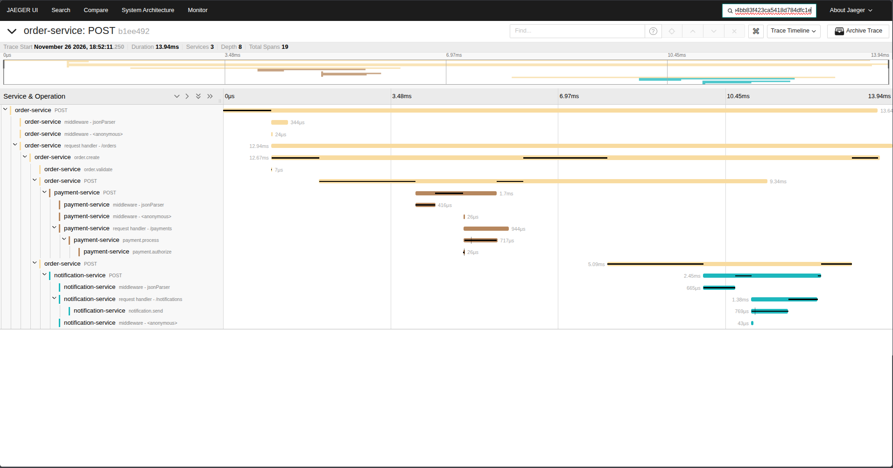
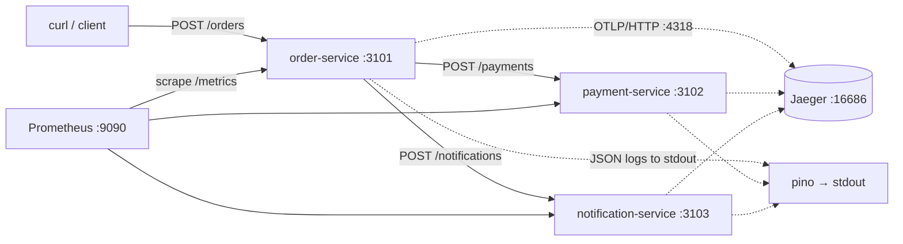
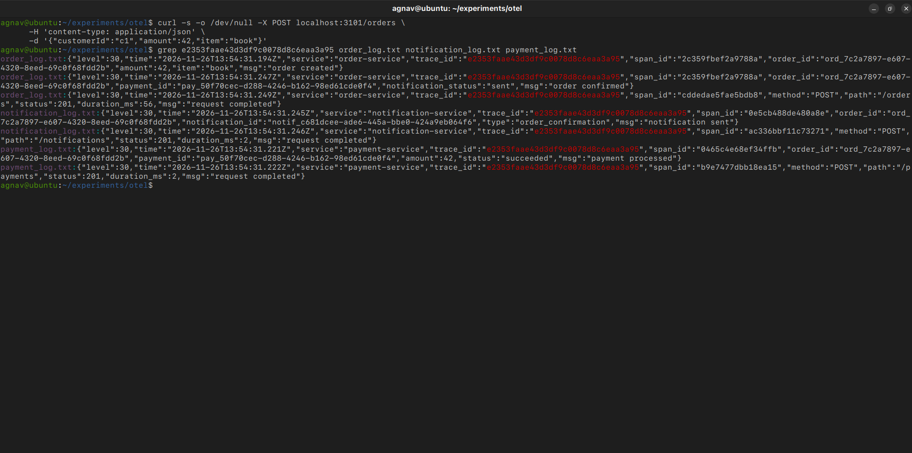
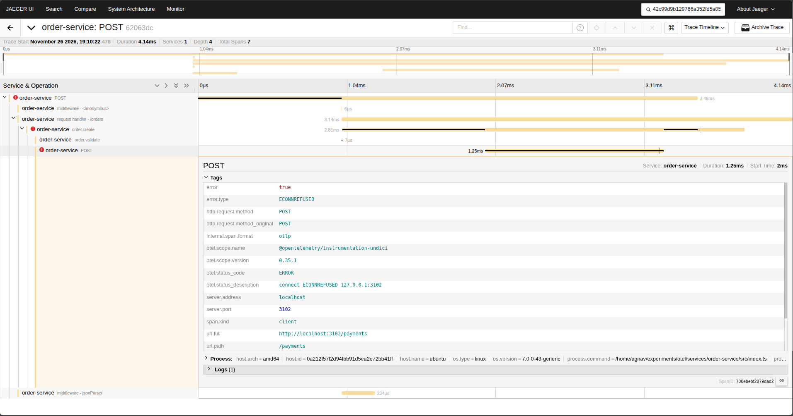
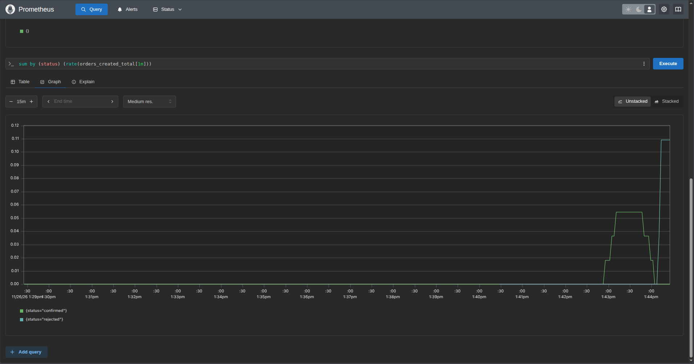
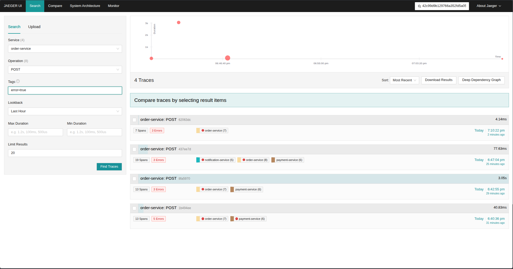
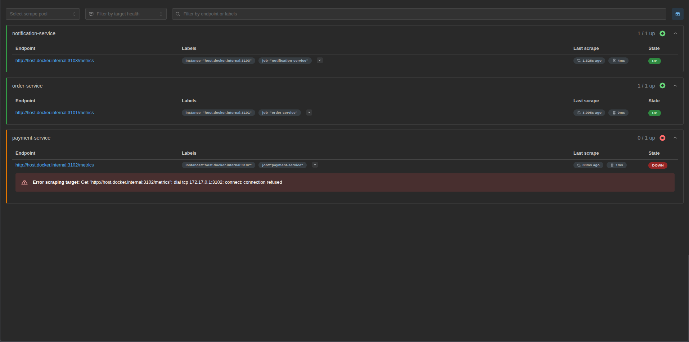
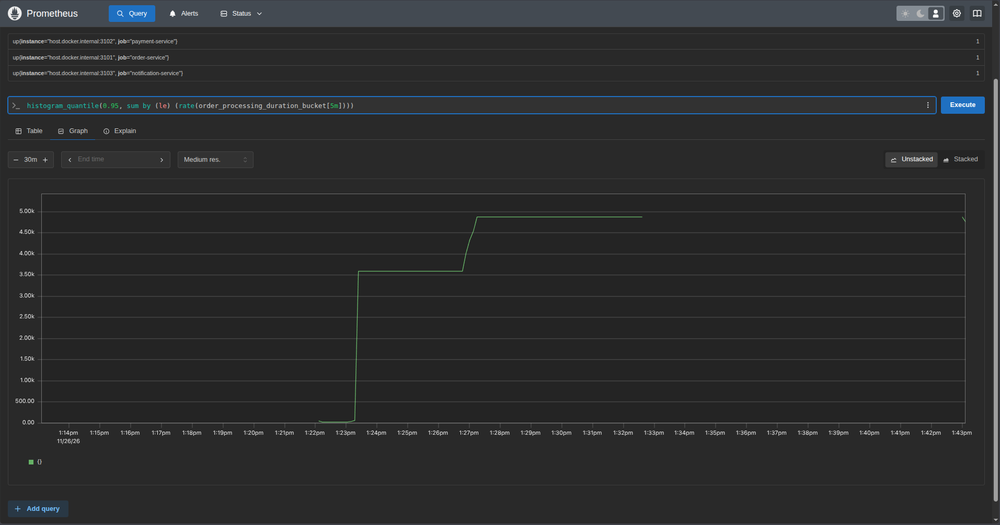

# OpenTelemetry Observability Lab

A hands-on distributed observability lab built from scratch: three Node.js/TypeScript services that talk to each other over HTTP, fully instrumented with **OpenTelemetry** — distributed traces, context propagation, structured logs, metrics, and real failure scenarios you can reproduce.

The goal was not to glue together a tutorial, but to understand *why* each piece exists by breaking it on purpose: strip the `traceparent` header and watch one trace become three; send a forged header and join a trace you don't own; add an unbounded metric label and watch time-series count explode; kill a dependency and follow one request across three services and three signals.

> Built incrementally, one concept per phase, with every claim verified in a running system rather than assumed from docs.



---

## Why this project exists

Most observability demos show a happy path: one request, green spans, a screenshot. This repo is about the parts that actually matter in production:

- **One request, three services, one trace.** Order → Payment → Notification, with W3C context propagated across process boundaries.
- **Three signals, joined.** A `trace_id` in a JSON log is the same ID you paste into Jaeger; the same request also increments Prometheus counters and histograms.
- **Failure is a first-class citizen.** Injected declines, automatic timeouts, slow dependencies, and a best-effort notification path that must not fail the order.
- **Observability decisions are explained.** Why `BatchSpanProcessor`, why bounded metric labels, why a dedicated package loaded before app code, why a timeout is a client-side decision.

## Architecture



| Service | Port | Role | Key spans |
|---|---|---|---|
| `order-service` | 3101 | Orchestrates the checkout | `order.create`, `order.validate` |
| `payment-service` | 3102 | Simulates card authorization | `payment.process`, `payment.authorize` |
| `notification-service` | 3103 | Best-effort confirmation | `notification.send` |

## What is implemented

| Signal | Implementation | Where to see it |
|---|---|---|
| **Traces** | OpenTelemetry NodeSDK, auto-instrumentation (HTTP, Express, undici) + manual spans, OTLP/HTTP export | Jaeger UI at `http://localhost:16686` |
| **Propagation** | W3C Trace Context + Baggage via `CompositePropagator` | `traceparent` across services; `isRemote: true` parent links |
| **Logs** | Pino JSON to stdout; `mixin` injects `trace_id`/`span_id` from the active span | Terminal output, greppable by trace ID |
| **Metrics** | OTel Metrics API with `PrometheusExporter` mounted at `/metrics` on each service port | Prometheus at `http://localhost:9090` |
| **Failure injection** | Environment-driven decline rate, latency, and client timeout | Reproducible scenarios below |

### One request, three signals

A single `trace_id` is what turns three independent data sources into one story. The same ID appears in the Jaeger waterfall, in every service's JSON logs, and it is the request those metrics counted.

*Logs from all three services for the same request: identical `trace_id`, different `span_id` per log site. This is the join key you paste into Jaeger when a dashboard goes red.*

### Instruments and metrics

| Metric | Type | Labels |
|---|---|---|
| `orders_created_total` | Counter | `status` (`confirmed` / `rejected`) |
| `order_processing_duration` | Histogram (ms) | `status` |
| `order_notification_failures_total` | Counter | — |
| `payments_processed_total` | Counter | `status` (`succeeded` / `failed`) |
| `payment_processing_duration` | Histogram (ms) | `status` |
| `notifications_sent_total` | Counter | `type`, or `status="failed"` |
| `notification_processing_duration` | Histogram (ms) | `type` / `status` |

Free extras from auto-instrumentation: `http_server_request_duration_*`, `http_client_request_duration_*` (undici), and `nodejs_eventloop_*`.

## Tech stack

- **Node.js 24+**, TypeScript 7, ESM, `tsx` as the runner
- **Express 5** for the HTTP APIs
- **pnpm 11 workspaces** (`services/*`, `packages/*`)
- **OpenTelemetry**: `sdk-node` 0.301.2, `sdk-trace` 3.1.1, `auto-instrumentations-node` 0.83.1, OTLP HTTP exporter, Prometheus exporter
- **Pino 10** for structured logging
- **Docker Compose**: Jaeger 1.62 (all-in-one) and Prometheus 3.1

## Repository layout

```
.
├── packages/
│   └── observability/          # @lab/observability — tracing.ts, logging.ts
├── services/
│   ├── order-service/          # :3101 — orchestrator
│   ├── payment-service/        # :3102 — failure injection lives here
│   └── notification-service/   # :3103 — best-effort path
├── infra/
│   ├── docker-compose.yml      # Jaeger + Prometheus
│   └── prometheus/prometheus.yml
├── API.md                      # request/response contracts
├── tsconfig.json
└── pnpm-workspace.yaml
```

The observability package is separate for one reason: instrumentation must be initialized **before** the app modules are imported, so each service starts with:

```bash
node --import tsx --import @lab/observability/tracing src/index.ts
```

`tracing.ts` calls `sdk.start()` at load time, before Express (and `undici`) are patched. That is also where the propagator, span processor, and metric reader are configured.

## Quick start

**Prerequisites:** Node.js 24+, pnpm 11+, Docker with Compose v2+.

```bash
git clone https://github.com/Agnav/otel.git
cd otel
pnpm install
```

Start Jaeger and Prometheus:

```bash
docker compose -f infra/docker-compose.yml up -d
docker compose -f infra/docker-compose.yml ps
```

Start the three services, one per terminal:

```bash
pnpm order
pnpm payment
pnpm notification
```

Send a request:

```bash
curl -s -X POST localhost:3101/orders \
  -H 'content-type: application/json' \
  -d '{"customerId":"c1","amount":42,"item":"book"}'
```

Expected: HTTP `201` with `orderId`, `payment`, and `notification` fields.

Open:

- **Jaeger** → <http://localhost:16686> — service `order-service`, **Find Traces**
- **Prometheus** → <http://localhost:9090> — **Status → Targets**, then the query box
- **Metrics** → `curl -s localhost:3101/metrics`

Shut down:

```bash
docker compose -f infra/docker-compose.yml down
```

## Configuration

All services read these:

| Variable | Default | Purpose |
|---|---|---|
| `PORT` | `3101` / `3102` / `3103` | Listening port |
| `OTEL_SERVICE_NAME` | set by `pnpm` script | `service.name` resource attribute |
| `LOG_LEVEL` | `info` | Pino level (`debug` shows authorization details) |
| `SPAN_EXPORTER` | `otlp` | Set to `console` to print spans to stdout instead of Jaeger |
| `OTEL_PROPAGATION` | `on` | Set to `off` to disable inject/extract and break the trace on purpose |
| `PAYMENT_SERVICE_URL` | `http://localhost:3102` | Downstream routing (order-service) |
| `NOTIFICATION_SERVICE_URL` | `http://localhost:3103` | Downstream routing (order-service) |

> Note: the standard `OTEL_PROPAGATORS` environment variable is **not honored** by this SDK version — verified by passing a bogus value with no effect. Propagation is configured explicitly in `packages/observability/src/tracing.ts`.

Failure injection:

| Variable | Default | Effect |
|---|---|---|
| `PAYMENT_FAILURE_RATE` | `0` | Fraction of payments declined (`1` = always) |
| `PAYMENT_LATENCY_MS` | `0` | Artificial delay before the payment decision |
| `PAYMENT_TIMEOUT_MS` | `2000` | Order-service client deadline for payment |
| `NOTIFICATION_FAILURE_RATE` | `0` | Fraction of notifications failing |
| `NOTIFICATION_LATENCY_MS` | `0` | Artificial notification delay |

## The learning path

Each phase added one concept and verified it in the running system.

| # | Phase | Core concept | What proves it worked |
|---|---|---|---|
| 1 | Workspace + services | pnpm monorepo, Express, HTTP fan-out | Three services answering on 3101–3103 |
| 2 | Auto-instrumentation | SDK before app code, library patching | ~11 spans per order with no manual code |
| 3 | Manual spans | `startActiveSpan`, attributes, events, status | `order.create` parents the downstream client spans |
| 4 | Context propagation | W3C `traceparent`, inject/extract, remote parents | One `traceId`, `isRemote: true` across processes |
| 5 | Structured logging | Pino `mixin`, active span context | Every log line carries `trace_id` + `span_id` |
| 6 | Metrics | Counters, histograms, cardinality | `/metrics` exposes business + HTTP metrics |
| 7 | Backends | OTLP export, Jaeger, Prometheus scraping | Trace waterfall in Jaeger, targets UP in Prometheus |
| 8 | Failure scenarios | Error status vs exception events, timeouts | Injected failures visible in all three signals |

## Reproduce the interesting parts

### 1. Watch one trace span three services

Send an order, open Jaeger, pick `order-service`. You should see ~15–20 spans in one trace with parent/child edges across all three services, and `order.create` as the root business span.

### 2. Break propagation on purpose

```bash
OTEL_PROPAGATION=off pnpm order   # only order-service, other two stay normal
curl -s -X POST localhost:3101/orders -H 'content-type: application/json' \
  -d '{"customerId":"c1","amount":10,"item":"book"}'
```

Payment and notification now start **their own traces**. One request becomes three unrelated traces — the classic "my distributed trace stops at the service boundary" symptom.

### 3. Forge a `traceparent` (you are the caller)

```bash
curl -s -X POST localhost:3102/payments \
  -H 'content-type: application/json' \
  -H 'traceparent: 00-11111111111111111111111111111111-2222222222222222-01' \
  -d '{"orderId":"ord_manual","amount":5}'
```

Every span from that request carries `traceId=1111…` and the server span's parent is `2222…` with `isRemote: true`. Replace the header with garbage and the receiver simply starts a new trace — telemetry headers must never break business traffic.

### 4. See the cardinality trap

Temporarily add `order_id` to the counter label in `order-service`:

```typescript
ordersCreated.add(1, { status, order_id: orderId }); // don't do this for real
```

Send a few orders and count series:

```bash
curl -s localhost:3101/metrics | grep -c '^orders_created_total{'
```

One series per order, forever. Revert to `{ status }` → two series total. High-cardinality IDs are fine in spans and logs, fatal in metric labels.

### 5. Follow one request through the logs

Send an order, then grep its trace ID across the three services' logs:

```bash
grep <trace_id> order_log.txt payment_log.txt notification_log.txt
```

Every matching line carries the same `trace_id` and a different `span_id`. That is the move from "the dashboard says checkout is slow" to "this specific request did exactly this, in this order".



### 6. Failure scenarios

```bash
# Payment declines every request
PAYMENT_FAILURE_RATE=1 pnpm payment
curl -s -X POST localhost:3101/orders ...   # → 502

# Payment is slow; order gives up first
PAYMENT_LATENCY_MS=3000 pnpm payment
PAYMENT_TIMEOUT_MS=1000 pnpm order
curl -s -X POST localhost:3101/orders ...   # → 502 after ~1s

# Notification fails, order still succeeds
NOTIFICATION_FAILURE_RATE=1 pnpm notification
curl -s -X POST localhost:3101/orders ...   # → 201
```

What to observe:

- **Payment decline:** `payment.process` and `order.create` are **ERROR** spans with an `exception` event; `payment.authorize` stays green because it completed before the throw.
- **Timeout:** order returns in ~1s with `error.type=23` on the undici client span, while payment keeps working and reports success at ~3s. Cancellation is local — the callee never knows.
- **Notification failure:** a red `notification.send` span inside an otherwise successful trace, plus `order_notification_failures_total` increments.



*Error semantics in one shot: the undici client span that failed with `ECONNREFUSED`, tagged `error=true` and `otel.status_code=ERROR`. The trace tells you the downstream service is down, not just that the order failed.*



*The same failure from the metrics side — confirmed and rejected orders as separate series under `sum by (status)`. Two signals, one incident.*

Once failures are flowing, search for them instead of hunting through traces:



## PromQL worth pasting

```promql
up{job=~".*-service"}

sum by (status) (rate(payments_processed_total[1m]))

sum(rate(orders_created_total{status="rejected"}[1m]))
/
sum(rate(orders_created_total[1m]))

histogram_quantile(0.95,
  sum by (le) (rate(order_processing_duration_bucket[5m])))

sum by (job) (rate(http_server_request_duration_count{http_response_status_code=~"5.."}[1m]))
```



*Scrape health first: if a target is down, the rest of the dashboards are lying to you.*



*A latency regression with no errors — the histogram catches what an error counter never will.*

## Engineering decisions and trade-offs

| Decision | Why |
|---|---|
| Dedicated `@lab/observability` package, loaded via `--import` | Instrumentation must patch libraries before the app imports them; config lives in one place |
| `BatchSpanProcessor` in normal mode, `SimpleSpanProcessor` for console mode | Production-like batching; instant feedback while learning |
| OTLP export instead of a vendor SDK | Jaeger speaks OTLP; the same code can ship to a Collector or any backend |
| Metrics through the OTel API + Prometheus pull reader | One instrumentation API, exporter swap only |
| Bounded metric labels only | Prevent unbounded time-series growth; IDs stay in spans/logs |
| Notification is best-effort | An order should not fail because a confirmation email failed |
| Explicit W3C propagator config | This SDK version ignores `OTEL_PROPAGATORS`; verified, not assumed |

## Screenshots

The images are embedded next to the claim they support. Full set:

| File | What it shows | Appears in |
|---|---|---|
| `docs/screenshots/jaeger-waterfall.png` | Full trace across all three services (hero image) | Top of README |
| `docs/screenshots/jaeger-error-span.png` | ERROR span with `error=true` and `otel.status_code` tags | Failure scenarios |
| `docs/screenshots/jaeger-error-search.png` | Search results filtered by `error=true` | Failure scenarios |
| `docs/screenshots/prometheus-targets.png` | All three scrape targets `UP` | PromQL |
| `docs/screenshots/prometheus-rejections.png` | Rejection-rate graph during failure injection | Failure scenarios |
| `docs/screenshots/prometheus-p95.png` | p95 latency spike during the slow-payment scenario | PromQL |
| `docs/screenshots/logs-correlation.png` | JSON logs from three services sharing one `trace_id` | One request, three signals; Follow one request through the logs |

## Production notes and limitations

This is a learning lab, deliberately scoped:

- Jaeger stores traces **in memory** — restarting the container loses history.
- No OpenTelemetry Collector, so no tail sampling, redaction, or fan-out yet.
- Prometheus and Jaeger run in Docker; the services run on the host (no Dockerfiles).
- No authentication/TLS — everything is localhost.
- No automated test suite; correctness is verified with `pnpm typecheck` and the reproducible scenarios above.
- No Grafana dashboards or alert rules committed; the PromQL above is the starting point.

Natural next steps: an OTel Collector with tail sampling (keep 100% of errors, sample successes), containerizing the services, alert rules + Grafana, and Loki for log search.

## Skills this demonstrates

- OpenTelemetry SDK configuration, auto- and manual instrumentation
- Distributed context propagation (W3C Trace Context, inject/extract, remote parents)
- Observability data modeling: spans/attributes/events vs logs vs metrics, and cardinality control
- Structured logging with trace correlation
- Prometheus exposition format, PromQL, scrape configuration
- Jaeger trace analysis and distributed failure debugging
- Docker Compose for local infrastructure
- TypeScript monorepo tooling (pnpm workspaces), ESM, Node.js async patterns
- Designing for failure: timeouts, error semantics, best-effort dependencies

## Further reading in this repo

- [`API.md`](API.md) — request/response contracts for all three services

## License

MIT — see [`LICENSE`](LICENSE).
